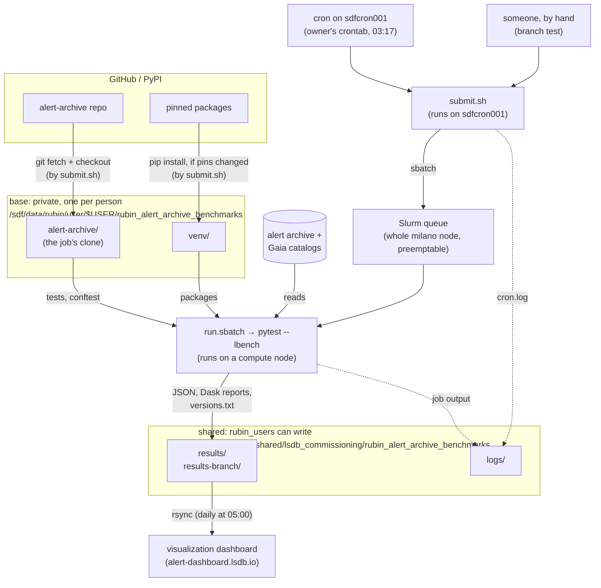

# Alert archive benchmarks

This directory holds timing benchmarks for common queries on the Rubin alert 
archive HATS catalog, run with 
[lf-bench](https://github.com/lincc-frameworks/lsdb-benchmarking) (`lbench`), a pytest plugin built on [pytest-benchmark](https://pytest-benchmark.readthedocs.io/). 

They run nightly on S3DF, with results published at
[alert-dashboard.lsdb.io](https://alert-dashboard.lsdb.io), and you can also
run them by hand.

| File | What it is |
|---|---|
| `test_alert_archive.py` | The benchmarks (one test per query) |
| `conftest.py` | Test configuration (catalog openers, session-scoped Dask cluster, and overrides of lf-bench's fixtures) |
| `diaObjectId_samples.npy` | Object IDs sampled for `test_naive_lc_aggregation` |
| `nightly/submit.sh` | Nightly cron entry point: updates the job's clone, checks the venv, submits the Slurm job |
| `nightly/run.sbatch` | The Slurm job that runs the benchmarks |
| `nightly/requirements.txt` | Pinned lsdb, hats, lf-bench, … versions for nightly runs |
| `nightly/rsync-bench.sh` | Copies the nightly results to the dashboard; run by a second cron job |

## Running benchmarks by hand

Run these from the repository root, in an environment with this repo's
dependencies installed (including lf-bench). The benchmarks read the catalogs
from `/sdf/data/rubin/...`, so they only run on S3DF.

### Running the full suite

```bash
cd ~/alert-archive
ALERT_ARCHIVE_CPROFILE=0 pytest --lbench benchmarks/
```

- `--lbench` turns on lf-bench: it creates a timestamped run folder, enables
  pytest-benchmark, and writes the results JSON there. Without it, every test
  fails with `lbench_run_dir not set — run pytest with --lbench option`.
- `ALERT_ARCHIVE_CPROFILE=0` skips the extra cProfile run of each test. Leave
  it out if you want the `.prof` files (see the diagram below).
- The full suite takes about 15–20 minutes. It's fine to run on an interactive
  node, but for anything you want to compare against nightly results, use the
  [branch run](#running-a-branch-the-way-the-nightly-job-does) below so it runs
  on the same hardware and pinned packages.

Early in the output you'll see:

```
[lbench] running benchmarks in .../lbench_results/<timestamp>
```

That folder holds your results. `lbench_results/` is gitignored.

### Running a single benchmark

`-k` selects tests whose names match an expression:

```bash
ALERT_ARCHIVE_CPROFILE=0 pytest --lbench benchmarks/ -k per_band
```

To list the test names first:

```bash
pytest benchmarks/ --collect-only -q
```

`test_naive_lc_aggregation` runs once per sample size (1, 100, 10,000). To
run one of those, give its full ID, in quotes because of the brackets:

```bash
ALERT_ARCHIVE_CPROFILE=0 pytest --lbench "benchmarks/test_alert_archive.py::test_naive_lc_aggregation[100]"
```

or combine names in `-k`, e.g. `-k "per_band or per_night"`.

### CLI Settings

| Variable | Default | Effect |
|---|---|---|
| `ALERT_ARCHIVE_CPROFILE` | `1` (on) | `0` skips the per-test cProfile run |
| `ALERT_ARCHIVE_DASK_WORKERS` | `2` | Number of Dask workers in the `LocalCluster` |
| `LBENCH_ROOT` | `./lbench_results` | Where lf-bench creates run folders |

Changing the worker count changes the timings, so results with different
worker counts aren't comparable.

lf-bench's `--lbench-root <dir>` option does the same as `LBENCH_ROOT`.

## Nightly runs

Every night at 03:17 Pacific, cron on `sdfcron001` (the only S3DF node where
user cron jobs are allowed) runs `nightly/submit.sh`, which:

1. resets the job's own clone of this repo to `origin/main`, so only merged
   work is benchmarked;
2. makes sure the job's venv matches `nightly/requirements.txt`, reinstalling
   when the pins change;
3. submits `nightly/run.sbatch` to Slurm.

The job runs on a whole `milano` node (RHEL 9.6) so timings are comparable
night to night. It uses the preemptable QOS: if a higher-priority job needs
the node, the run is cancelled and that night has no results.

If a run fails or hits its time limit, Slurm emails the job's owner (the
`--mail-user` address in `nightly/run.sbatch`). That covers branch runs too,
whoever starts them. Failures in `submit.sh` itself, before a job is
submitted, don't send email; they only show up in `logs/cron.log`.

Files live in two places, split by who may write them:

```
/sdf/data/rubin/shared/lsdb_commissioning/rubin_alert_archive_benchmarks/
├── results/             nightly results from main; one folder per run
├── results-<branch>/    results from branch runs
└── logs/
    ├── cron.log         one line per step of each submit.sh run, by anyone
    ├── rsync-bench.log  output of each rsync to the dashboard
    └── <jobid>.out      output of each Slurm job

/sdf/data/rubin/user/<owner>/rubin_alert_archive_benchmarks/
├── alert-archive/       the job's clone; reset on every run, don't edit it
├── venv/                pinned packages from nightly/requirements.txt
└── pip.log              output of venv (re)installs
```

- **Results and logs** are in a shared folder next to the alert archive
  itself. Everyone in `rubin_users` can read and write them, so anyone can
  look at or clean up results. The nightly results are also copied every
  morning to a machine at CMU that serves them at alert-dashboard.lsdb.io
  (see [Publishing to the dashboard](#publishing-to-the-dashboard)).
- **The clone and venv** are in a private folder, one per person who runs
  `submit.sh`, writable only by that person. They're the code the job runs,
  under the account of whoever started it; if anyone else could edit them,
  they could run their own code under that account. `submit.sh` creates both
  automatically on its first run, so there's nothing to set up by hand.

`ALERT_ARCHIVE_NIGHTLY_SHARED` and `ALERT_ARCHIVE_NIGHTLY_BASE` override the
two locations.

How the pieces connect. `base` and `shared` are the names `submit.sh` uses
for the private and shared folders:



Solid arrows are the main flow; dotted arrows are logs. Everything in `base`
is code the job runs, so only its owner can change it; everything in
`shared` is output.

### Running a branch the way the nightly job does

To benchmark a branch on the nightly setup (same hardware, same pinned
packages), push it to GitHub, then on `sdfcron001`, run `submit.sh` from your
own checkout of this repo:

```bash
ssh sdfcron001
~/alert-archive/benchmarks/nightly/submit.sh <branch>
```

Anyone in `rubin_users` can run this. The first time, it creates your private
clone and venv (a few minutes); after that it reuses them. The job uses the
`rubin:default` Slurm account, so you need access to it.

- The branch must be pushed; the script checks out `origin/<branch>`.
- Results go to the shared `results-<branch>/` (with `/` in the name replaced
  by `_`), so they stay separate from the nightly history.
- With no argument, `submit.sh` benchmarks `main`, the same as the cron job.
- Don't start a run while one of your own is still queued or running
  (`squeue -u $USER`): your runs share your clone, and a new run resets it
  under the old one.
- If the branch changes `nightly/requirements.txt`, your venv is reinstalled
  with its pins. Your next run from `main` puts `main`'s pins back.
- Changes to `submit.sh` itself take effect one run after they're pushed:
  the script reads its own code before it fetches the new version.

### Checking on a run

```bash
B=/sdf/data/rubin/shared/lsdb_commissioning/rubin_alert_archive_benchmarks
tail $B/logs/cron.log                              # did submit.sh run, which commit, which job ID?
squeue -u $USER                                    # PD = waiting for a node, R = running
tail -f $B/logs/<jobid>.out                        # live output
sacct -j <jobid> -o JobID,State,Elapsed,MaxRSS     # COMPLETED / FAILED / PREEMPTED, time, memory
```

A `FAILED at line N` entry in `cron.log` means `submit.sh` itself failed
(e.g. a git or pip problem). The error message from the failing command is
logged just above it. Each line names who ran it; for install errors, check
`pip.log` in that person's private folder.

Cron runs `submit.sh` with a much smaller environment than your login shell
(no `module load slurm`, a minimal `PATH`, `SHELL=/bin/sh`), and `sbatch`
passes that environment on to the job, so a run that works by hand can still
fail under cron. To try it the way cron runs it, on `sdfcron001`:

```bash
env -i HOME=$HOME SHELL=/bin/sh PATH=/sbin:/bin:/usr/sbin:/usr/bin \
    /sdf/data/rubin/user/$USER/rubin_alert_archive_benchmarks/alert-archive/benchmarks/nightly/submit.sh
```

This submits a real job, so check its `.out` file in `logs/` afterwards too.

### Publishing to the dashboard

[alert-dashboard.lsdb.io](https://alert-dashboard.lsdb.io) runs the
[lsdb-benchmarking dashboard](https://github.com/lincc-frameworks/lsdb-benchmarking)
on a machine at CMU (lsdb.phys.cmu.edu). A second cron job copies the nightly
results there every day at 05:00 Pacific, from a crontab on `sdfcron001`.
Current owner: Sandro (`stavar`).

```bash
0 5 * * * $HOME/alert-archive/benchmarks/nightly/rsync-bench.sh
```

Cron runs `nightly/rsync-bench.sh` from the owner's clone of this repo. The
script runs rsync over SSH, logging in to the CMU machine as its `benchmarks`
user with a key kept on USDF. It syncs the contents of the shared `results/`
folder into a volume mounted on the dashboard's Docker container.

- **What lands in `results/` gets published.** Only the results for main
  get copied. Do not include sensitive information in this folder, as its
  contents will be made public.
- **New runs show up the morning after.** 05:00 leaves time for the run
  submitted at 03:17 to finish. If a run takes longer, it will be published
  the next day. The dashboard rereads the results on every page load, so
  nothing needs restarting on the server.

The script logs each rsync result to `nightly/rsync-bench.log` in the owner's
clone (gitignored), and at the end of each run replaces `logs/rsync-bench.log`
in the shared folder with a copy of it, which people in the `rubin_users` group
can read and write to. It doesn't append to `logs/rsync-bench.log` directly,
because anyone in `rubin_users` could replace it with a link to one of the owner's
files and have the cron job write there.

### Changing pinned versions

Edit `nightly/requirements.txt` and merge to `main`. The next nightly run
reinstalls the venv. Version changes then line up with commits in this repo,
so a jump in the results can be traced to them.

### Handover

The benchmark code lives in this repo, and the results and logs are in the
shared folder, so neither depends on one person. What's tied to the owner is
the cron entry (in their crontab on `sdfcron001`; crontabs can't be shared)
and their private clone and venv, which the new owner doesn't need: their
first run builds their own. Current owner: Olivia Lynn (`olynn`).

To take over:

1. **Stop the old cron entry.** The previous owner runs `crontab -e` on
   `sdfcron001` and deletes the line. Otherwise both entries run and the job
   runs twice a night. If the previous owner's account is gone, so is their
   crontab.
2. **Run it once by hand** on `sdfcron001`, from your own checkout:
   ```bash
   ssh sdfcron001
   ~/alert-archive/benchmarks/nightly/submit.sh
   ```
   This creates your private clone and venv, and submits a run of `main`
   (see [Checking on a run](#checking-on-a-run)).
3. **Add your own cron entry** with `crontab -e` on `sdfcron001`, pointing
   at the clone the first run created (`<you>` is your username):
   ```
   17 3 * * * /sdf/data/rubin/user/<you>/rubin_alert_archive_benchmarks/alert-archive/benchmarks/nightly/submit.sh
   ```
4. **Update the repo** in a PR: (1) the owner named in this section, and (2) the
   `--mail-user` address at the top of `nightly/run.sbatch`, which gets an
   email from Slurm whenever a run fails or hits its time limit.

The previous owner's private folder can be deleted once the new setup works;
only they (or an admin) can delete it.

To take over the rsync of results to the dashboard:

1. **Stop the old cron entry.** The previous owner runs `crontab -e` on
   `sdfcron001` and deletes the line.
2. **Get access to the CMU machine.** Make an SSH key without a passphrase,
   and have someone with access to the CMU machine add its public key to
   `~benchmarks/.ssh/authorized_keys` there. Then connect once by hand,
   to accept the machine's host key:
   ```bash
   ssh benchmarks@lsdb.phys.cmu.edu true
   ```
3. **Keep the previous owner's log.** Your runs replace the shared log with a
   copy of your own, so rename theirs first:
   ```bash
   cd /sdf/data/rubin/shared/lsdb_commissioning/rubin_alert_archive_benchmarks/logs
   mv rsync-bench.log rsync-bench-<previous-owner>.log
   ```
4. Clone this repo, and keep it on main:
   ```bash
   git clone https://github.com/lincc-frameworks/alert-archive.git $HOME/alert-archive
   ```
5. **Add your own cron entry** with `crontab -e` on `sdfcron001`:
   ```bash
   0 5 * * * $HOME/alert-archive/benchmarks/nightly/rsync-bench.sh
   ```

## Reading results

Each run folder contains:

- `pytest-benchmark.json`: per-test timing stats, plus Dask metrics under
  `extra_info.dask` (`peak_memory_bytes`, `n_tasks`, path to the performance
  report). pytest-benchmark also records the node and the git commit.
- `dask_performance_report_*.html`: one per test; open it in a browser to see
  the task stream and worker memory.
- `versions.txt` (nightly and branch runs only): Slurm job ID, node, LSST
  env, alert-archive commit, and `pip freeze` of the venv.

In the summary table pytest prints:

- Numbers in parentheses are ratios to the best value in that column.
- **Outliers** `A;B`: A is the number of rounds more than 1 standard
  deviation from the mean (1–2 of 5 is normal); B is the number outside
  1.5 × IQR, the standard box-plot outlier rule. A single B outlier in one
  run usually means a brief hiccup, e.g. on the shared filesystem.
- **Rounds** should be 5 (see below).

## What one benchmark runs

Each test builds a query and passes its `.compute` to the `lbench_dask`
fixture. `conftest.py` overrides lf-bench's `lbench` fixture, so one test
runs the query like this:

```
test_xxx(alert_archive, lbench_dask)
│
└─ lbench_dask(func)                              ← lf-bench
   │
   ├─ lbench(func)                                ← conftest.py override
   │   │
   │   ├─ benchmark.pedantic(func)                ← pytest-benchmark
   │   │   ├─ warm-up round   func()  ×1   untimed; warms caches
   │   │   └─ timed rounds    func()  ×5   these are the reported stats
   │   │
   │   ├─ memray     func()  ×1   only for tests marked lbench_memory (none are)
   │   └─ cProfile   func()  ×1   skipped when ALERT_ARCHIVE_CPROFILE=0
   │
   └─ run_dask_benchmark(func)    ×1   Dask task stream, peak worker memory,
                                       performance report
                                   ───
                             total  7 full .compute() calls per test
                                    (8 with cProfile on)
```

Things this means for interpreting results:

- **Timings are warm-cache.** The warm-up round reads the data from disk
  first, so the timed rounds mostly read from the OS page cache. That's
  deliberate, but it means the numbers describe repeated queries, not a
  first query on a cold node.
- **The Dask metrics come from a separate run**, not from the timed rounds.
- **The cProfile run only profiles the driver process.** The real work runs
  in the Dask workers, so it shows mostly waiting. That's why it's off in
  nightly runs.
- **What's inside the timer:** every test opens the catalog *before* calling
  `lbench_dask`, so opening it isn't timed. Most tests also build the query
  beforehand and time only `.compute()`; `test_per_night_counts` and
  `test_per_band_counts` time a function that also builds the query and sums
  the per-partition counts.
- **The Dask cluster is shared across tests** in a session, so a test can
  benefit from data an earlier test already read.

## Known issues

- A run that's interrupted (Ctrl-C, preemption, timeout) leaves a run folder
  with no `pytest-benchmark.json`, because results are only written at the
  end. That's expected; check `sacct` or the job's `.out` file to see what
  happened.
