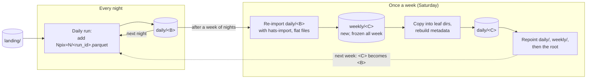

# Serving daily and weekly catalogs side by side

Draft design, 2026-11-24. Builds on the [incremental data flow](incremental_data_flow.md)
design and the weekly re-import (step 8).

## Problem

Only lsdb v0.11.2 and on can read catalogs with leaf directories (eg, a directory 
`Norder=5/Dir=0/Npix=6928/` of parquets, instead of `Norder=5/Dir=0/Npix=6928.parquet`) 
over HTTP. Older versions of lsdb cannot; this includes the lsdb in the RSP image (0.11.x).

We want to serve two catalogs next to each other:

- **Daily:** the newest alerts, in leaf directories holding several files
  each. Over HTTP, only lsdb ≥ 0.11.2 can read it.
- **Weekly:** the last weekly re-import, never changed afterwards, in flat
  files that any recent lsdb can read.

The two are almost the same data. At the moment of a re-import, the daily
catalog equals the weekly one. After that, the daily one is the weekly one plus
the daily runs' files. So each weekly run makes the weekly catalog, then copies
it into the daily catalog's layout for the next week's daily runs to add to.

This is a stopgap until RSP ships lsdb ≥ 0.11.2. 

## Proposal

### Layout

We maintain two kinds of catalogs within the collection:
- the weekly, in flat files
- the daily, with leaf directories

```text
collections/                                  published root (public URL, cosmicdata symlink)
├── collection.properties                     DEFAULT: weekly/<B>/… or daily/<B>/… (decision 1)
├── weekly/
│   ├── collection.properties                 → <B>/rubin_alert_archive_<B>, margin, index
│   ├── <A>/                                  previous version
│   └── <B>/                                  current; made by that week's re-import, then never changed
│       ├── collection.properties
│       ├── rubin_alert_archive_<B>/          flat: dataset/Norder=k/Dir=d/Npix=N.parquet
│       ├── rubin_alert_archive_<B>_10arcs/
│       └── rubin_alert_archive_<B>_diaSourceId/
└── daily/
    ├── collection.properties                 → <B>/rubin_alert_archive_<B>, …  (the pipeline's write target)
    ├── <A>/                                  previous version; no longer written to
    └── <B>/                                  current; made by that week's re-import, then grown in place by daily runs
        ├── collection.properties             same content as weekly/<B>/collection.properties
        ├── rubin_alert_archive_<B>/          leaf dirs: Npix=N/Npix=N.parquet  (copy of weekly's Npix=N.parquet)
        │                                                Npix=N/<run_id>.parquet (daily runs)
        ├── rubin_alert_archive_<B>_10arcs/   copy of weekly's
        └── rubin_alert_archive_<B>_diaSourceId/   copy of weekly's
```
where `<A>` and `<B>` are version IDs: the UTC date (`YYYYMMDD`) of the weekly
re-import that made each version, e.g. `20261114` and `20261121`. `<B>` is the
current version and `<A>` the one before it, which is kept for users who still
have it open. One weekly run builds both `weekly/<B>/` and `daily/<B>/`, so a
version has the same ID in both trees.

How users open each one:

| You want | Open | Needs |
|---|---|---|
| The default (weekly, decision 1) | `<root>` | any recent lsdb |
| The newest alerts | `<root>/daily` | hats ≥ 0.11.2 (lsdb ≥ 0.11.2) over HTTP; any recent version by local path |
| The last weekly re-import | `<root>/weekly` | any recent lsdb |
| An older weekly | `<root>/weekly/<A>` | any recent lsdb |

`<root>` is `http://slac.data.lsdb.io:10942/lsdb/rubin_alert_archive/` or
`/sdf/data/rubin/cosmicdata/lsdb/rubin_alert_archive`, or the mirror's
equivalents (see [Mirroring](#the-mirror)).

### The pipeline



**Daily run:** unchanged, except that
`current_catalog_dir` (in `collection.py`) reads
`daily/collection.properties` instead of the root's. The pipeline's write
target no longer depends on what users get by default.

**Weekly run:**

1. Re-import `daily/<B>` into `weekly/<C>/`, as today, but with the main
   catalog in **flat files** (`npix_suffix=".parquet"` instead of `"/"`).
   hats-import fails if `weekly/<C>` doesn't have as many rows as `daily/<B>`.
2. Copy `weekly/<C>/` to `daily/<C>/`, and switch the copy's main catalog to
   leaf directories: move each `Npix=N.parquet` to `Npix=N/Npix=N.parquet`,
   set `hats_npix_suffix=/`, and rebuild its metadata.
3. Check that `daily/<C>` has as many rows as `weekly/<C>`. With step 1's
   check, no alert is lost between `daily/<B>` and `daily/<C>`.
4. Repoint `daily/`, then `weekly/`, then the root. Each pointer always names
   a complete catalog, so readers never see a half-built version.
5. Delete every version but `<C>` and `<B>`, in both trees.

Everything else in the weekly run is unchanged (format-change flag, lock,
orphan cleanup, marking runs consolidated; see `weekly/run.py`). As today, a
failure before step 4 leaves
the pointers untouched.

**Migration (one time):** today the live catalog is `working/`, which the
daily runs write to directly and the public symlink points at.
`collections/` doesn't exist yet. To switch over:

1. Move `working/` to `collections/daily/<date>/rubin_alert_archive_<date>/`,
   and write `collections/daily/collection.properties` pointing at it. This
   makes today's catalog the first daily version.
2. Switch the daily run to write to the catalog that
   `collections/daily/collection.properties` points at, instead of `working/`.
3. Run the weekly run once, to create `weekly/<C>` and the root pointer.
4. Point the public symlink at `collections/`.

### The mirror

A mirror at UW (the Shire) pulls `collections/` with rsync and serves it too.
Its sync script isn't part of this design. Some things its author may want to
know:

- **Pointers:** switching to a new version only changes the three
  `collection.properties` files. If rsync copies one before the version it
  names has finished copying, the mirror points at an incomplete catalog
  until the sync ends. A second rsync for just those three files avoids that.
- **When the catalog changes:** the daily run writes at about 05:07 Pacific
  (5–10 minutes, at most an hour), and the weekly run on Saturdays at 08:00
  Pacific. `state/lock` exists while either one is writing.
- **Directory listings:** reading the daily catalog over HTTP needs the web
  server to serve them, because hats finds each pixel directory's files
  through its index page. Without them, the mirror can still serve the weekly
  catalog.

Each sync after a daily run copies only that run's new files. A sync after a
weekly run copies two new versions, about 17 GB each today.

## Decisions

### 1. What the root points to

The root's `collection.properties` is what anyone opening the published URL
gets. It's one config value. The weekly run writes it at each swap, and a small
command could rewrite it at any time. Both catalogs also have their own stable
paths. So this choice only decides who has to add `/daily` or `/weekly`, and
flipping it later breaks nobody who uses an explicit path.

| | **A: root → daily** | **B: root → weekly** |
|---|---|---|
| Fresh by default | Yes, the newest alerts | Up to a week old (the re-import runs Saturdays) |
| lsdb ≤ 0.11.1 (incl. RSP) at the root over HTTP | Fails with an `ArrowInvalid` error. Users have to know about `/weekly` | Works |
| Margin and index | Miss alerts since the re-import | Match the main catalog |
| Readers see a daily run in progress | Yes (known issue) | Never: weekly catalogs don't change |
| Pixel sizes | Grow all week | Balanced |
| Same results all week | No | Yes |
| Matches today's behavior | Yes: the public URL serves the daily-updated catalog now | No, a change for current users |

**Personally, in iterating on this document, I'm leaning heavily to B after all.** RSP ships lsdb 0.11.x, so with A the root would fail for
every RSP user, and for anyone else whose hats is older than v0.11.2
(November 2026). B works for all of them and is internally consistent.
People who want the newest alerts add `/daily` (with hats ≥ 0.11.2), and the
docs and benchmarks can point there explicitly.

Revisit A once RSP ships hats ≥ 0.11.2. Flipping the default then takes one
config change, and nobody using `/daily` or `/weekly` notices.

### 2. How the duplicate is stored

**Proposed: plain copies.** Each version's data is stored twice, about 17 GB
extra per version today (main catalog, margin and index), or about 34 GB with
the previous version kept. The same applies on the mirror. That's fine for a
stopgap of a few months.

Considered and dropped:

- **Hard links**, so both trees share one copy on disk. They save the space,
  but add too much complication and room for error. Plus, space isn't really an issue at this point.
- **Symlinks.** They break if the target is deleted first, and they'd need to
  be relative to survive the rsync.
### 3. The weekly main catalog's file layout

**Flat files (`Npix=N.parquet`), required.** The re-import writes
single-file leaf directories today (`Npix=N/Npix=N.parquet`). Over HTTP, hats
< 0.11.2 can't read those either (lsdb#1612), so a weekly catalog in that
layout wouldn't help RSP users at all.

## Alternatives considered

**Do nothing; old lsdb users upgrade.** No new code or disk. Ruled out: RSP
ships lsdb 0.11.x. Upgrading hats alone would fix it, but we can't ask every
RSP user to do that before the archive works for them.

**Weekly base plus a daily delta catalog.** Keep the weekly catalog as is, and
rebuild a small separate catalog each night of only the alerts since the last
re-import (flat files, with its own margin and index). Every lsdb reads both,
nothing is stored twice, and nothing has multi-file leaf directories. But users
who want fresh data have to combine two catalogs themselves (`concat`,
crossmatching against both, `id_search` twice), since a collection has only
one main table. It also replaces the daily-run design we just built. 

## Compatibility check

The cutoff and the failure mode are known (see above). Before going live,
check over HTTP, from both the SLAC server and the mirror:

- **With RSP's lsdb 0.11.x:** the weekly catalog opens and reads fully, both
  as `<root>/weekly` and through the root. This is what we promise RSP users.
- **With hats ≥ 0.11.2:** the daily catalog returns every file's rows in
  multi-file leaves. hats-cloudtests covers leaf directories, but only with
  one file each. Check this against a server that has directory listings
  turned on.

`weekly_test/` can be the test copy, once it's in the new layout and a daily
run has added files to it.

## Changes

| Where | Change |
|---|---|
| `collection.py` | `daily/` and `weekly/` trees. `current_catalog_dir` reads the daily pointer. `set_current_version` writes the three pointers. Version listing and deletion work per tree. `adopt_working` moves `working/` into `daily/<date>/` and writes only the daily pointer. |
| `daily/run.py` | Write to `current_catalog_dir` (the daily pointer) instead of `working/`. |
| `weekly/reimport.py` | Write the main catalog flat. `output_path` is `collections/weekly`. |
| `weekly/` (new function) | Build `daily/<C>` from `weekly/<C>`: copy it, move the main catalog's files into leaf dirs, set `npix_suffix=/`, `update_metadata`, row-count check. |
| `weekly/run.py` | New step order (above). Clean up a half-built `<C>` in both trees. |
| `config.py` | `default_catalog: "daily" \| "weekly"`, plus a CLI command to repoint the root. |
| Tests | Weekly files unchanged by daily runs. The daily `<C>` matches the weekly `<C>` row for row. The weekly catalog opens with `npix_suffix=.parquet`. A failed weekly run leaves every pointer as it was. |
| Docs | Overview layout. "Using the catalog": which path, which lsdb/hats, what RSP users get by default, and the hats-only upgrade as a workaround. Known issues. Runbook: rolling back means repointing three files; changing the default. |
| Benchmarks | Point explicitly at `/daily` or `/weekly`, not the root. |
| Public symlink | Retarget `cosmicdata/lsdb/rubin_alert_archive` from `working/` to `collections/` (Sandro owns it), as the last migration step. |
