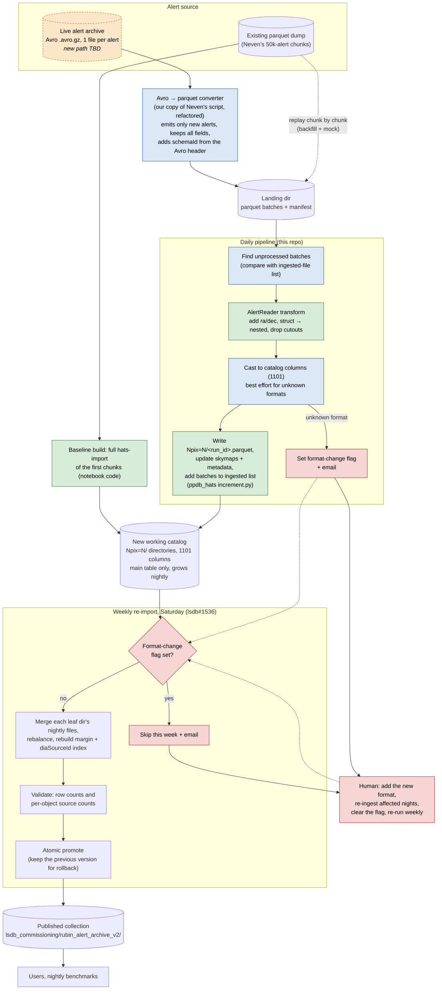

# Incremental alert archive: data flow

Draft design for nightly updates to the alert archive HATS catalog.
Weekly re-import and publishing are tracked in
[lsdb#1536](https://github.com/astronomy-commons/lsdb/issues/1536).

Key: green = existing code (from the notebook or ppdb_hats), blue = new code
for this repo, red = alert-format-change handling, orange dashed = not settled yet.

## Decisions

### Catalog and storage

- **The frozen catalog is not touched or reused.** The new catalog is rebuilt
  in a new directory from the parquet dump: a baseline hats-import of the
  first chunks, then the remaining chunks replayed through the daily pipeline.
  The replay is also the mock source until live alerts flow, and it tests the
  increment code on real alerts. The dump has 20.6M rows, against 15.3M in the
  frozen catalog. Its files fall into four write dates: 347 from Jun 26 (likely
  the frozen catalog's input, so a natural baseline), then 87 from Jul 13,
  10 from Jul 21 and 66 from Jul 31 (about 5.3M newer alerts to replay).
- **Location:** `/sdf/data/rubin/shared/lsdb_commissioning/rubin_alert_archive_v2/`,
  holding a `working/` catalog plus the published versions that lsdb#1536
  needs for promote and rollback.
- **Pipeline state** lives in `rubin_alert_archive_v2/state/`, outside the
  catalog so it survives the weekly re-import:
  - `ingested.jsonl`: one line per daily run, with the run ID, its start
    time, the parquet file name it wrote, its input chunks, its row count and
    its `schemaId` counts. It also lists the chunks the run skipped, with their
    errors, so the summary email can say how long a chunk has been failing.
    Only the input chunks count as ingested. Nightly files are named by run ID,
    not date, so a manual re-run can't overwrite an earlier run's files.
  - `format_change.json`: present only while flagged. Its existence is the flag.
  - `lock`: an atomic lock file so the daily and weekly jobs never overlap.
    If a job dies without removing it, nothing breaks it automatically: the
    next job fails loudly until a person checks and deletes it.

### Input and alert formats

- **The converter lives in this package.** It's our own copy of Neven's
  Avro → parquet script, refactored as needed. It is responsible for the
  "only new alerts" guarantee, for keeping every field, and for writing a
  per-alert `schemaId` column read from the Avro header (bytes 1–4).
- **`schemaId` is mocked for now.** Neven's dump has no format ID and uses
  one uniform column set: no 1101 fields, and every field nullable. So the
  mock infers it from the columns present: `1101` if any of the four 1101
  `diaSource` fields exist, otherwise `1100`. 1000 and 1100 differ only in
  nullability, so the dump can't tell them apart. It doesn't matter here,
  because both cast to the catalog the same way. The real value replaces the
  mock once the converter rewrite lands. The 170xxx raw Avro files are still on
  disk, so the real IDs could be recovered later if needed.
- **Format 1101 is supported.** The new catalog uses the 1101 columns. Rows
  from 1000/1100 alerts get nulls for the four new `diaSource` fields
  (`exposureTime`, `reliabilityVersion`, `trailAlgorithm`, `trail_flag`).
- **Unknown alert formats:** the daily pipeline keeps running and writes those
  alerts as well as it can. It also sets a format-change flag and sends an email.
  While the flag is set, the Saturday re-import skips aggregation and sends an email.
  A person then adds the format, re-ingests the affected nights, clears the flag
  and re-runs the weekly job. Nightly files are only merged by the weekly job,
  so re-ingesting a night means deleting that night's files and taking its
  batches off the ingested list. We expect this once or twice over the next few months.

### Operations

- **Notification:** email via `mail`, to a configurable list of recipients.
  It starts with olynn@andrew.cmu.edu; others can be added as wanted.
- **Safe re-runs:** after writing, the daily run recomputes row counts and
  max rows from the parquet footers on disk rather than adding to the old
  totals (unlike ppdb_hats). A run that crashes and is repeated can't
  double-count rows in the metadata.

### Accepted trade-offs (for now)

- **Pixel growth is acceptable for now.** The daily import never splits existing
  pixels. It only adds new pixels for alerts outside the current coverage.
  Pixels keep growing until the weekly re-import, and longer if a
  format-change flag makes it skip.
- **Stale margin and index are acceptable for now.** They are rebuilt only by
  the weekly re-import.

## Open questions

- **Source:** what is the new path of the live archive, and are alerts flowing yet?
- **Converter (deferred):** for now the pipeline starts from parquet chunks in
  the landing dir. Notes for when we port Neven's `import_alerts.py`:
  - It imports two helper modules, `probe` and `avro_to_arrow`, that we don't
    have yet. They contain the decoding and `build_canonical_schema`.
  - It builds tables with `pa.Table.from_pylist(records, schema=CANON)`, which
    silently drops keys missing from the fixed schema. That is probably why the dump has
    no 1101 fields. The Avro header's format ID is read during decoding but not kept.
  - It assumes new alerts always arrive in new raw subdirs and existing subdirs
    never change. Subdirs are alertId prefixes, not nights, so this should be checked.
  - It also strips `ssSource` and `mpc_orbits`, not just the cutouts.
- **Email delivery:** `mail` exists on the interactive nodes. Does it actually
  deliver when run from the nightly job? `mail` exiting cleanly only means it
  accepted the message, not that it was delivered, so the only real check is
  sending a test email from a batch job.

## Implementation plan

Small PRs, each reviewable in one sitting. PRs 2–4 don't depend on each
other or on the cluster. Nothing touches the shared filesystem until PR 6,
and nothing runs on a schedule until PR 9.

| # | PR | Contents | Size |
|---|---|---|---|
| 1 | **Design doc** | This document | no code |
| 2 | **Reader** | `reader.py` (the notebook's `AlertReader`), small test fixtures cut from the dump, tests | small |
| 3 | **Schema** | `schema.py`: 1101 target columns, casting, `schemaId` mock, unknown-format detection | small |
| 4 | **State + notify** | `state.py` (ingested log, format-change flag, lock), `notify.py` (email) | small |
| 5 | **Increment** | `daily/increment.py` from ppdb_hats with recompute-from-disk metadata; `config.py`, `pipeline.py` | medium |
| 6 | **Baseline** | `baseline.py`: full import of the Jun 26 chunks into `working/` | small |
| 7 | **Daily run + replay** | `daily/run.py`, `mock/replay.py`, end-to-end test (baseline → replay one night) | medium |
| 8 | **Weekly scaffold** | `weekly/run.py`: flag check, skip and email; merge itself deferred to lsdb#1536 | small |
| 9 | **Scheduling** | cron/Slurm scripts, run against the real v2 directory | small |
