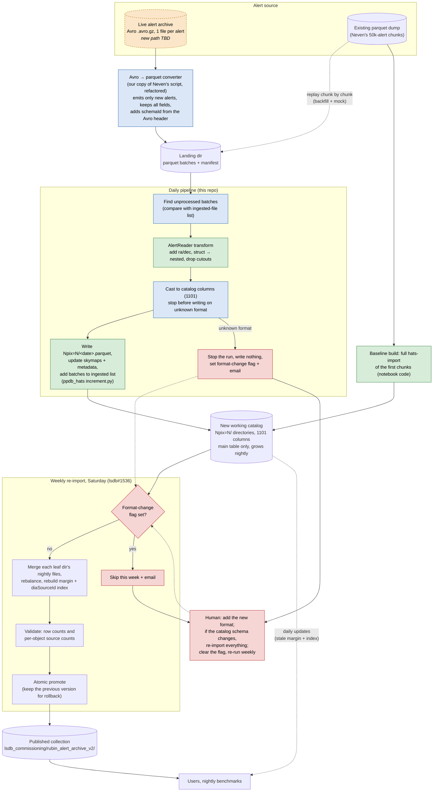

# Incremental alert archive: data flow

Draft design for nightly updates to the alert archive HATS catalog.
Weekly re-import and publishing are tracked in
[lsdb#1536](https://github.com/astronomy-commons/lsdb/issues/1536).

Key: green = existing code (from the notebook or ppdb_hats), blue = new code
for this repo, red = alert-format-change handling, orange dashed = not settled yet.

## Decisions

### Catalog and storage

- **The frozen catalog is not touched or reused.** The new catalog is rebuilt
  in a new directory from the parquet dump: a baseline hats-import of the
  first chunks, then the remaining chunks replayed through the daily pipeline.
  The replay is also the mock source until live alerts flow, and it tests the
  increment code on real alerts. The dump has 20.6M rows, against 15.3M in the
  frozen catalog. Its files fall into four write dates: 347 from Jun 26 (likely
  the frozen catalog's input, so a natural baseline), then 87 from Jul 13,
  10 from Jul 21 and 66 from Jul 31 (about 5.3M newer alerts to replay).
- **Location:** `/sdf/data/rubin/shared/lsdb_commissioning/rubin_alert_archive_v2/`,
  holding a `working/` catalog plus the published versions that lsdb#1536
  needs for promote and rollback.
- **Pipeline state** lives in `rubin_alert_archive_v2/state/`, outside the
  catalog so it survives the weekly re-import:
  - `ingested.jsonl`: one line per daily run, with the run ID, the parquet
    file name it wrote, its input chunks, its row count and its `schemaId`
    counts. Nightly files are named by run ID, not date, so a manual re-run
    can't overwrite an earlier run's files.
  - `format_change.json`: present only while flagged. Its existence is the flag.
  - `lock`: an atomic lock file so the daily and weekly jobs never overlap.

### Input and alert formats

- **The converter lives in this package.** It's our own copy of Neven's
  Avro → parquet script, refactored as needed. It is responsible for the
  "only new alerts" guarantee, for keeping every field, and for writing a
  per-alert `schemaId` column read from the Avro header (bytes 1–4).
- **`schemaId` is mocked for now.** Neven's dump has no format ID and uses
  one uniform column set: no 1101 fields, and every field nullable. So the
  mock infers it from the columns: the newest known format whose columns
  match exactly, or unknown if none do. 1000 and 1100 differ only in
  nullability, so the dump can't tell them apart. It doesn't matter here,
  because both cast to the catalog the same way. The catalog stores the
  inferred value, so alerts from the dump are all labelled `1100`, including
  any that were really `1000`. The real value replaces the
  mock once the converter rewrite lands. The 170xxx raw Avro files are still on
  disk, so the real IDs could be recovered later if needed.
- **Format 1101 is supported.** The new catalog uses the 1101 columns. Rows
  from 1000/1100 alerts get nulls for the four new `diaSource` fields
  (`exposureTime`, `reliabilityVersion`, `trailAlgorithm`, `trail_flag`).
  `prvDiaSources` reuses the `diaSource` definition, so it gets the same four fields.
- **`ssSource` and `mpc_orbits` are left out for now (may revisit).** All three
  alert formats include them for solar-system alerts (about 21% of alerts),
  but Neven's dump and the frozen catalog drop them. These values exist only
  in the raw Avro alerts; the converter strips them before writing parquet,
  so nothing downstream can recover them. Revisit this when we port the
  converter, where we can choose to keep them. Adding them later changes
  the catalog's columns, which needs a weekly re-import.
- **Unknown alert formats stop the pipeline.** Users read the working catalog
  directly, so best-effort rows would reach them the same day. When a daily run
  finds an alert format it doesn't know, it writes nothing, sets the
  format-change flag and sends an email. While the flag is set, daily runs stop
  and the Saturday re-import skips (and emails). Nothing bad is written, so the
  unknown chunks simply stay off the ingested list. A person then:
  1. adds the format;
  2. if the new format changes the catalog's columns, re-imports the whole
     catalog (or upgrades every file) to the new schema, since every file must
     share one schema;
  3. clears the flag. The next daily run ingests the waiting chunks normally.

  For now the format is detected from the mocked `schemaId` and the cast
  report; once the converter keeps the real `schemaId`, it can stop at the
  first alert with a new one. We expect this at most once or twice over the next
  few months, so it is meant to be an all-hands event rather than handled
  automatically. (Decided 2026-10-29; this replaces "keep ingesting best
  effort".)
- **One schema for every file.** `write_partitions` checks each night's
  partitions against the catalog's `_common_metadata` schema, nested fields
  included, and fails if a column or type differs. If only some partitions
  differ, it deletes the night's files already written, so nothing is left.
  Only nullability and field order are cast to match. This also catches
  schema drift that isn't a new alert format, e.g. from a library upgrade.
  `update_metadata` writes `partition_info.csv` and `hats.properties` before
  combining the footers into `_metadata`, so if that ever fails, the pixels
  and row counts are already right.

### Operations

- **Notification:** email via `mail`, to a configurable list of recipients.
  It starts with olynn@andrew.cmu.edu; others can be added as wanted.
- **Safe re-runs:** after writing, the daily run recomputes the metadata from
  the files on disk rather than adding to the old totals (unlike ppdb_hats):
  the pixel list from the leaf directories, row counts and max rows from the
  parquet footers, `_metadata` and the per-partition column statistics from
  the same footers, and the skymaps from each file's spatial index column. A
  run that crashes and is repeated can't double-count rows, and runs deleted
  by a re-ingest drop out at the next update. The rebuild reads the whole
  catalog every night: about 4 s for the skymaps (16.5M rows of ra/dec) and
  2 s for the parquet metadata (227 files) today.
  How it scales is tracked in an issue ([#22](https://github.com/lincc-frameworks/alert-archive/issues/22)).
- **Orphaned files:** a run that crashes after writing its files but before
  adding itself to `ingested.jsonl` leaves files that no run owns. Its chunks
  get ingested again next time, so the daily run deletes leaf files whose
  names aren't in the log (or the baseline) before it ingests. True orphans
  always come from one crashed run, newer than every logged run, so the
  cleanup refuses to delete anything else. A truncated log or a missing
  baseline name then stops the run instead of deleting the catalog.

### Error handling

Failures are loud, but a problem with some of the data doesn't stop the rest
from being ingested. Each failure is handled at the smallest level that
contains it:

| Level | Example | What happens | How it's recovered |
|---|---|---|---|
| **Field** | A new alert format changes a field's type, or adds or removes fields | All alerts are kept. Unknown fields are dropped, missing ones are filled with nulls, and a field that can't be converted is set to null for every alert in that chunk, not just the ones with bad values. Sets the format-change flag. | After the code is fixed, re-ingest the flagged runs: delete the catalog files those runs wrote (`Npix=*/<run_id>.parquet`, listed in `ingested.jsonl`), drop their log lines, re-run. Their input chunks are still on disk. |
| **Chunk** | A corrupt or truncated parquet file | That chunk is skipped and its error recorded; every other chunk is ingested. | Automatic: a skipped chunk never enters `ingested.jsonl`, so the next nightly run finds it again. If it needs a code fix, the first run after the fix picks it up. |
| **Run** | Catalog not writable, disk full, lock held | The run stops with an error rather than risk a half-written catalog. | Fix the cause and re-run. Safe because metadata is recomputed from disk. |

- **One summary email per run**, not one per error. It lists format changes
  (with the fields dropped or set to null), skipped chunks with their errors,
  and chunks that have kept failing ("failing since <date>"), so a chunk that
  fails every night doesn't look like news each time.
- **Schema checks happen at development time.** `avro_schema_to_arrow` raises
  on any Avro feature it doesn't support. It only runs on our own copies of the
  known schema files, so that error shows up in tests, never in a nightly run.
- **Where each part lives:** `schema.py` doesn't catch errors or send email.
  It returns the converted table plus a report of what it dropped, filled
  or set to null, and which `schemaId`s it saw. The daily run decides what to
  do per chunk, and `notify.py` sends the email.
- **Not handled yet: individual bad alerts.** An alert without usable `ra`/`dec`
  can't be placed on the sky. The dump marks both as non-null, so we don't
  expect this. If it happens, those rows could go to
  `state/rejected/<run_id>.parquet` with a reason column.

### Accepted trade-offs (for now)

- **Pixel growth is acceptable for now.** The daily import never splits existing
  pixels. It only adds new pixels for alerts outside the current coverage.
  Pixels keep growing until the weekly re-import. While a format-change flag
  is set, the daily runs stop too, so nothing grows while the merge waits.
- **Stale margin and index are acceptable for now.** They are rebuilt only by
  the weekly re-import. Users reading the working catalog between re-imports
  can miss crossmatches with new alerts near pixel boundaries, and
  `id_search` by `diaSourceId` doesn't find alerts added since the last
  re-import.
- **Users read the working catalog directly.** It is updated daily, with no
  snapshot in between, so readers see the run as it happens:
  - While a daily run is writing, new files in existing pixels show up at
    once, but new pixels, row counts and skymaps catch up only when the run
    updates the metadata at its end.
  - A reader that opened the catalog before files were deleted, by a
    re-ingest or the orphan cleanup, can hit `FileNotFoundError`. Reopening
    the catalog fixes it.
  - The metadata files (`partition_info.csv`, `hats.properties`,
    `_metadata`, `_common_metadata`, `per_partition_statistics.parquet` and
    the skymaps) are overwritten in place. A reader that opens the catalog
    while one is being written, a window of a few seconds per night, can
    get a parse error or miss pixels. Reopening fixes it. Writing each file
    to a temporary name and renaming it into place would close this, but we
    think it isn't worth the extra code yet. Followed up in an issue (#24).

## Open questions

- **Source:** what is the new path of the live archive, and are alerts flowing yet?
- **Converter (deferred):** for now the pipeline starts from parquet chunks in
  the landing dir. Notes for when we port Neven's `import_alerts.py`:
  - It imports two helper modules, `probe` and `avro_to_arrow`, that we don't
    have yet. They contain the decoding and `build_canonical_schema`.
  - It builds tables with `pa.Table.from_pylist(records, schema=CANON)`, which
    silently drops keys missing from the fixed schema. That is probably why the dump has
    no 1101 fields. The Avro header's format ID is read during decoding but not kept.
  - It assumes new alerts always arrive in new raw subdirs and existing subdirs
    never change. Subdirs are alertId prefixes, not nights, so this should be checked.
  - It also strips `ssSource` and `mpc_orbits`, not just the cutouts.
- **Email delivery:** `mail` exists on the interactive nodes. Does it actually
  deliver when run from the nightly job?

## Implementation plan

Small PRs, each reviewable in one sitting. PRs 2–4 don't depend on each
other or on the cluster. Nothing touches the shared filesystem until PR 6,
and nothing runs on a schedule until PR 9.

| # | PR | Contents | Size |
|---|---|---|---|
| 1 | **Design doc** | This document | no code |
| 2 | **Reader** | `reader.py` (the notebook's `AlertReader`), small test fixtures cut from the dump, tests | small |
| 3 | **Schema** | `schema.py`: 1101 target columns, casting, `schemaId` mock, unknown-format detection | small |
| 4 | **State + notify** | `state.py` (ingested log, format-change flag, lock), `notify.py` (email) | small |
| 5 | **Increment** | `daily/increment.py` from ppdb_hats with recompute-from-disk metadata, one-schema write check, orphan-file cleanup; `config.py`, `pipeline.py` | medium |
| 6 | **Baseline** | `baseline.py`: full import of the Jun 26 chunks into `working/` | small |
| 7 | **Daily run + replay** | `daily/run.py` (incl. stop + flag + email on an unknown format, orphan cleanup at start), `mock/replay.py`, end-to-end test (baseline → replay one night) | medium |
| 8 | **Weekly scaffold** | `weekly/run.py`: flag check, skip and email; merge itself deferred to lsdb#1536 | small |
| 9 | **Scheduling** | cron/Slurm scripts, run against the real v2 directory | small |
| 10 | **Converter** | Port of Neven's `import_alerts.py`: Avro → parquet, keeps all fields (incl. 1101), per-alert `schemaId` from the Avro header, only new alerts; decide on `ssSource`/`mpc_orbits`; replaces the `schemaId` mock | medium |
