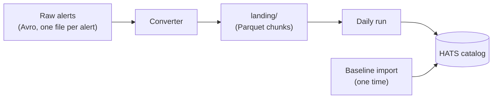

# How the catalog is built

Where alerts come from, and every step they take before they're in the catalog.

:::{admonition} Stub
:class: note

To do:

- Each stage above: what it does, who owns it, where its files live on USDF
- The catalog's layout: the working catalog, `state/`, and file naming
  per run
- How the pieces map to modules (`baseline`, `daily.run`, `daily.increment`,
  `state`, `notify`, `schema`, `reader`)
- Link to the [design doc](../design/incremental_data_flow.md) for the reasoning
:::
