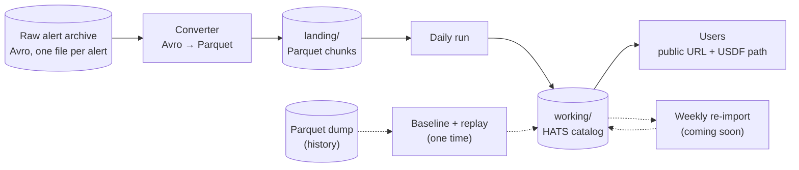

# How the catalog is built

Rubin archives every alert it sends as a separate Avro file. A converter batches
new alerts into Parquet files, and a daily run adds those to the HATS catalog
that people query.



## The stages

**Raw alert archive.** Rubin writes each alert to
`/sdf/data/rubin/shared/alert-archive/v2/alerts/<prefix>/<alertId>.avro.gz`,
where `<prefix>` is the first six digits of the alert ID. A prefix holds roughly
one night of alerts. The `v2` in this path is the archive's own version and
has nothing to do with our catalog's `rubin_alert_archive_v2`.

**Converter (in progress).** A cron job converts each new prefix directory into Parquet chunks
of up to 50,000 alerts and writes them to `landing/`. More info coming soon!

**Daily run.** This finds the chunks in `landing/`
that no run has ingested yet, checks that their alert format is one the catalog
supports, and adds their alerts to `working/`. Each run writes one new file into
every catalog pixel it touches and updates the catalog's metadata. See
[The daily run](daily_run.md).

**The catalog.** `working/` is the catalog people use. It's published as
`/sdf/data/rubin/cosmicdata/lsdb/rubin_alert_archive`, a symlink to `working/`,
and at <http://slac.data.lsdb.io:10942/lsdb/rubin_alert_archive/>.

**Weekly re-import (coming soon).** The daily runs never split a pixel, so pixels
keep growing, and the catalog has no margin catalog or `diaSourceId` index yet.
A weekly job will merge each pixel's daily files, repartition, and rebuild the
margin and index.

**Scheduling (coming soon).** For now, the daily run is started by hand with
`sbatch scripts/daily.sbatch`. A cron job will start it every day.

**Baseline and replay (one time).** The catalog was started from Neven's
Parquet dump of the archive, until alerts stopped flowing in mid-July 2026
(`/sdf/data/rubin/user/ncaplar/alert-parquet`; its last alert is from July 14):
a full import of its first chunks, then the rest replayed through the daily run,
one night at a time. You don't need either to run the pipeline. See
[How the catalog was first built](first_build.md).

## Where everything lives

Everything the pipeline reads and writes is under one root,
`/sdf/data/rubin/shared/lsdb_commissioning/rubin_alert_archive_v2/`:

```text
rubin_alert_archive_v2/
├── landing/
│   ├── manifest.json                         the converter's list of converted prefixes
│   └── 171141__00000000-00050000.parquet     <prefix>__<first>-<last>.parquet
├── state/
│   ├── ingested.jsonl                        one line per run: its chunks and alert counts
│   ├── format_change.json                    only while the format-change flag is set
│   └── lock                                  only while a run is in progress
└── working/                                  the HATS catalog
    ├── hats.properties, partition_info.csv, skymap.fits, ...
    └── dataset/Norder=<k>/Dir=<d>/Npix=<pixel>/
        ├── Npix=<pixel>.parquet              alerts from last weekly consolidation
        └── 20261102T225212Z.parquet          alerts from one daily run, named by its run ID
```

Note that `state/` sits next to the catalog and not inside it. [State and notifications](state_and_notifications.md)
explains each file.

You may also see `baseline_*` and `replay_*` directories next to these. They're
backups of the catalog and its state from the baseline and the replay, kept
until we're fully confident in the live catalog.

## The code

| Module | What it does |
|---|---|
| {py:mod}`alert_archive.daily.run` | The daily run, from finding new chunks to the summary email |
| {py:mod}`alert_archive.daily.increment` | Writes a run's alerts into the catalog's pixels, rebuilds the skymaps and metadata, and cleans up after a crashed run |
| {py:mod}`alert_archive.reader` | Reads landing chunks into the catalog's shape: adds `ra`/`dec`, nests the sources, drops the image cutouts |
| {py:mod}`alert_archive.schema` | The alert formats the catalog supports (1000, 1100, 1101) and how alerts are cast to the catalog's columns |
| {py:mod}`alert_archive.state` | The ingested log, the format-change flag and the lock |
| {py:mod}`alert_archive.notify` | The emails each run sends |
| {py:mod}`alert_archive.config` | Paths, Dask settings and hats-import settings, with defaults for S3DF |
| {py:mod}`alert_archive.baseline` | The one-time baseline import |
| {py:mod}`alert_archive.mock.replay` | The one-time replay of the Parquet dump |

The Slurm scripts that run them are in `scripts/`: `daily.sbatch`,
`baseline.sbatch` and `replay.sbatch`. For why the pipeline is built this way,
see the [design doc](../design/incremental_data_flow.md).
